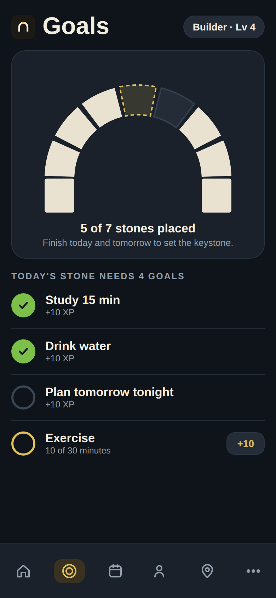
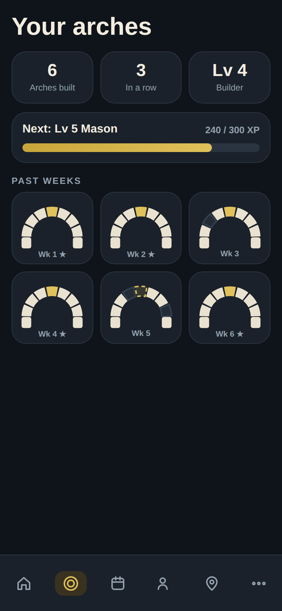

# Future Goals layout: "Build the Arch"

Status: **designed, not built.** Saved on 2026-10-23 to pick up later. The Calm and
Streak layouts shipped first (`src/components/GoalsLayouts.jsx`, picker in More,
Goals layout).

## The idea

Each day you finish your goals, a stone goes into a weekly arch. Day seven sets the
gold keystone. The metaphor is the app's own name and logo.

## How it should work

- **Seven stones per week**, placed from both sides inward, ending with the gold
  keystone on day seven. Placement order left to right in the arch:
  Mon, Wed, Fri, Sun (keystone), Sat, Thu, Tue. The mockup generator is in the
  session notes, but the math is simple: 7 equal wedges of a half ring, with the
  middle wedge gold.
- **A stone is placed when the day counts**, using the same rule as the Streak
  layout (`dayStatus` in `src/data/helpers.js`, "all goals" or "any one goal").
- **A miss leaves a gap**, not a reset. The week can still be finished, and a gap
  shows as a dark, empty stone. This fits the "one missed day a week" rest rule
  already in `computeGoalStreak` / `computeDayStreak`.
- **Today's goals** sit below the arch as the same one tap list as Calm.
- **"Your arches"** collects past weeks as small arches, with a star and a gold
  keystone on complete ones. Stats: arches built, arches in a row.
- **XP and levels are optional.** The mockup shows Apprentice, Builder, Mason.
  Recommendation: skip XP in the first version. It adds data and balance questions
  for little gain.

## Data

No new saved data is needed for the first version. Everything derives from
`goal.progress` per day:

- stone state for a day = `dayStatus(goals, date, rule)` (`met` places a stone)
- arch complete = all 7 days `met` (or the chosen threshold)
- collection = walk back week by week with `startOfWeek` / `weekKey`

A "Layout" value of `arch` would be one more option for `settings.goalsStyle`.

## Pro gating

Recommended: Pro, alongside the Streak layout.

## Open questions

1. Does the arch count weekly goals, or only daily goals (as the Streak layout does)?
2. Is a week "complete" at 7 of 7 days, or something forgiving like 6 of 7?
3. Sunday as the keystone day assumes weeks start Monday. The app can also start
   weeks on Sunday (`sundayWeekStart` in `helpers.js`), so the stone order must
   follow the user's week start.

## Rough effort (a guess)

Large: SVG arch component, a stone placement animation, the collection screen,
and tests for week boundaries. Estimated several focused sessions.

## Why it was parked

It is the biggest build, has slower daily feedback than a day streak, and the
simpler layouts should be tried with real users first. Revisit once Calm and Streak
usage shows what people actually use.
